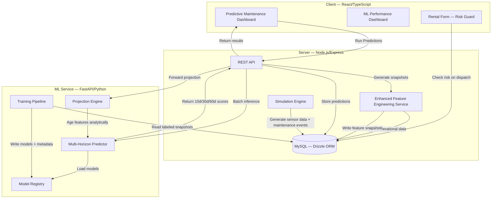

# Enterprise Asset Intelligence — Architecture

> A full-stack predictive maintenance platform for rental fleet operations.  
> Combines a React/Node.js application with a Python ML service to predict equipment failure across 10, 30, and 60-day horizons — with forward trajectory projection, cost-optimized intervention recommendations, and a rental dispatch risk guard.

---

## Table of Contents

1. [Problem Statement](#problem-statement)
2. [System Architecture](#system-architecture)
3. [ML Pipeline](#ml-pipeline)
4. [Feature Engineering](#feature-engineering)
5. [Model Design Decisions](#model-design-decisions)
6. [Model Performance](#model-performance)
7. [Completed Feature Tracks](#completed-feature-tracks)
8. [Known Limitations](#known-limitations)
9. [Tech Stack](#tech-stack)

---

## Problem Statement

Rental fleet operators face two compounding problems:

- **Reactive maintenance** — equipment fails in the field during a rental, damaging the customer relationship and incurring emergency repair costs significantly higher than scheduled maintenance
- **Suboptimal dispatch** — without failure probability signals, dispatchers assign equipment based on availability alone, routing borderline units into long-term rentals where a field failure is most costly

Pure preventive maintenance schedules address the first problem partially but cannot inform the second at all. A unit can be within its PM interval and still have a 45% probability of failure in the next 10 days based on its actual wear trajectory.

This system builds toward the optimal intervention point: the moment when expected failure cost exceeds preventive maintenance cost. That calculation requires forward-projected failure probabilities, not just current risk state.

```
Expected failure cost   = P(failure) × (repair cost + downtime cost + customer impact)
Preventive maint. cost  = labor + parts + scheduled downtime

→ Intervene when: Expected failure cost > PM cost
```

---

## System Architecture



### Data Flow — Inference

```
Operational Data (sensor logs, maintenance events, rentals)
    ↓
Enhanced Feature Engineering Service (Node.js)
    → 31 features extracted per equipment per snapshot date
    → Derived features recomputed fresh at inference (not stored)
    → Saved to asset_feature_snapshots
    ↓
FastAPI Multi-Horizon Predictor
    → Loads the champion named in the model registry, with its version-pinned artifacts
    → Clips features to training distribution bounds
    → Returns calibrated probabilities for 10d / 30d / 60d
    ↓
Dashboard
    → Risk level classification, with bands set per horizon (see Inference)
    → Trend direction (INCREASING when the 60d band is worse than the 10d band, otherwise STABLE)
    → Top risk drivers per horizon
    → 60-day trajectory curve (projection engine)
    → Optimal PM intervention day (cost model)
```

### Data Flow — Training

```
asset_feature_snapshots (labeled with 10d/30d/60d outcomes)
    ↓
train_model_multihorizon.py
    → Temporal holdout (latest ~20%) with a per-horizon embargo
    → TimeSeriesSplit CV (5 folds, gap = horizon days)
    → Separate Random Forest per horizon, class_weight='balanced', no resampling
    → CalibratedClassifierCV at real prevalence (sigmoid for 10d, isotonic for 30d/60d)
    → Log-transform 7 skewed features, drop raw versions (38 → 31 features)
    ↓
Model Registry
    → rf_{horizon}d_v{version}.pkl
    → feature_importance_{horizon}d_v{version}.json
    → clip_thresholds_v{version}.json
    → feature_cols_v{version}.json
    → metadata_{horizon}d_v{version}.json
    → label_encoder_category_v{version}.pkl
```

---

## ML Pipeline

### Simulation Engine

Real-world equipment failure data is rare, imbalanced, and expensive to collect, so the training data comes from a simulator. Every metric in this document is measured on simulated data and verifies the pipeline, not field performance.

- **Breakdown hazard** (`server/services/failure-hazard.ts`): daily breakdown probability = *base(age, hours)* × *condition*. Condition worsens with use and is restored by scheduled work: a major service most, a minor service some. An inspection restores nothing, and neither does a breakdown repair. One module drives both the training-history generator and the in-app day simulator, so the model is scored on the process it learned.
- **Training history** (`scripts/generate-training-history.ts`): 160 units over about three years, each kept to a diligent, average or neglectful maintenance policy. Without that spread, days since service carries no information however strongly it drives failure. The run is seeded, so the dataset is reproducible.
- **Snapshots** are taken in step with the simulation through the same `enhancedFeatureService` the API scores with, then labelled with the same `labelSnapshots()`.
- **Daily sensor readings** are generated per unit: vibration XYZ, engine temp, oil pressure, hydraulic pressure, fuel consumption, RPM.
- **Fleet renewal:** a unit past 10 years of age, or 8 years and 8,000 hours, is retired and replaced (`EQ-R{id}-{year}` naming).

v2.0 exists because the previous process could not show the effect of maintenance: in v1.17's data, service almost never changed whether a machine failed, so logging a service did not move its score. The README tells that story in full.

### Labeling

Each feature snapshot is labeled with three binary outcomes:

- `will_fail_10d` — was there a `REACTIVE_REPAIR` event in `(ts, ts+10d]`?
- `will_fail_30d` — within 30 days?
- `will_fail_60d` — within 60 days?

Labels are assigned retrospectively from the maintenance event log, and only a `REACTIVE_REPAIR` breakdown counts as a failure. Scheduled PM and model-driven interventions never do.

Rows whose outcome window contains a `PREDICTIVE_INTERVENTION` before any failure are **censored** (`label_status`) rather than labelled negative. Otherwise the model's own successes would poison its future labels.

### Training

Three separate Random Forest classifiers are trained, one per horizon, using temporal cross-validation. Each horizon's holdout is the most recent ~20% of snapshots, and dev rows whose label window crosses the holdout boundary are dropped (192 / 672 / 1,312 rows for 10d / 30d / 60d). A by-asset evaluation (`GroupKFold(5)` over `equipment_id`) scores every asset with a model that never saw it. The training script (`train_model_multihorizon.py`) is triggerable from the admin UI — it runs as a background subprocess, streams output to a live log drawer, and hot-swaps the loaded models in FastAPI on completion.

Version is auto-incremented from the last DB record. No version string appears in inference code.

**MLflow integration:** Each training run is logged to the `equipment-failure-multihorizon` experiment with hyperparameters, per-horizon metrics (ROC-AUC, PR-AUC, recall, F1, distribution shift, CV mean/std), per-fold ROC-AUC as a step metric, sklearn model artifacts, feature importance JSONs, and clip thresholds. Opt-in via `MLFLOW_TRACKING_URI` env var — safe no-op if unset. Reproducibility is enforced via `RANDOM_SEED = 42` applied to `np.random.seed()` and all RF estimators.

### Explainability

`shap.TreeExplainer` is initialized at predictor startup for each horizon's base RF (extracted from `calibrated_classifiers_[0].estimator`). At inference time, `_get_shap_attribution(df_aligned, horizon)` returns the top 5 features by |SHAP value|, appended to every horizon's prediction response as `shap_attribution`. SHAP values are log-odds from the uncalibrated RF — sign and rank are reliable; magnitude is not directly comparable to `failure_probability`.

### Drift Detection

Three-layer drift detection runs post-batch:

**Layer 1 — Data drift (PSI):** Population Stability Index computed on five monitored features: `mean_time_between_failures`, `vendor_reliability_score`, `mechanical_wear_score`, `neglect_score` and `hours_used_90d`. 5 quantile bins, 1/n additive smoothing, persisted to `drift_metrics` table with `feature`, `psi`, `status`, `ref_mean`, `cur_mean`, `ref_std`, `cur_std`. PSI thresholds: `< 0.10` STABLE · `0.10–0.20` WARNING · `≥ 0.20` ALERT.

**Layer 2 — Prediction drift:** Distribution of 30d output scores compared to reference via KL divergence and mean shift. Detects when the model's output distribution changes even if input features look stable — can indicate label drift or silent model degradation.

**Layer 3 — Bias drift:** HIGH-risk rate per equipment category compared across periods. Detects disparate impact — e.g., if a new fleet cohort is systematically scored higher/lower than the reference period for that category. Surfaced as percentage-point disparity per category.

Reference distribution bootstrappable via `POST /drift/compute-reference` — writes `drift_reference.json` to registry and immediately runs a post-reset check so the dashboard reflects the new baseline.

### Champion-Challenger Model Governance

Each completed training run calls `register_new_version(version)` in `engine/model_registry.py`:

- **First version** → becomes champion immediately; loaded by `mh_predictor` at startup
- **Subsequent versions** → enter as challenger; loaded by `challenger_predictor` in shadow mode
- **Shadow scoring:** Challenger runs alongside champion on every batch inference call. Results are NOT persisted to DB — shadow output is returned in `shadow_summary` (mean Δ30d score) for monitoring only
- **Promotion:** `POST /api/ml/models/promote` (admin only) swaps `mh_predictor = challenger_predictor` in memory — zero-downtime, no restart required; old champion moved to `retired`
- **Registry:** `registry/model_registry.json` tracks champion, challenger, retired list, and full audit history (register/promote events with timestamps)
- **Numeric version sort:** `_version_key()` extracts (major, minor) tuple; `v1.12 > v1.9` regardless of string sort
- **What the pages show:** the metrics pages describe the champion. A newly trained challenger's numbers appear only in the comparison table until it is promoted

### Pre-Training Data Quality Gate

`engine/data_quality.py` runs 8 checks before any training begins:

| Check | FAIL threshold | WARN threshold |
|-------|---------------|----------------|
| Row count | < 500 rows | < 1,000 rows |
| Label completeness | Any horizon has no positive labels | < 10 positives per horizon |
| Class balance | < 10 positives or < 2% positive rate per horizon | < 30 positives or < 5% positive rate |
| Null rate | > 20% nulls in any feature | > 5% |
| Physical bounds | Any negative age/hours | — |
| Required non-zero | All snapshots have zero hours | — |
| Temporal spread | Date span < 60 days | < 180 days |
| Duplicate snapshots | (warning only) | > 5% duplicates |

FAIL → raises `ValueError`, training aborted. WARN → logs message, training proceeds. The report is also surfaced via `GET /api/ml/data-quality/report` in the ML dashboard.

### No Resampling

SMOTE was removed. It ran before `CalibratedClassifierCV`, so the calibrator fit on a resampled class balance and the emitted probabilities were inflated. Imbalance is now handled by `class_weight='balanced'`, and calibration runs on the real-prevalence dev set. Brier score and expected calibration error are published per horizon, with a gate of ECE < 0.05.

### Agent API & Monitoring

The agent API provides bearer-token authenticated access to model health for programmatic consumers (scripts, LLM agents, CI/CD):

- `GET /api/agent/model-health` — returns model version, pipeline stats, drift status (all three layers), and a machine-readable `recommended_action` (`none` / `retrain` / `compute_drift_reference`) with a `reasoning` string
- `POST /api/agent/actions` — triggers `retrain` or `compute_drift_reference` without a browser session

`monitor.py` is a local cron script that calls `GET /api/agent/model-health`, logs three-layer drift per feature, triggers the recommended action automatically, and fires a Slack webhook alert (Block Kit payload) when action is needed or any drift layer hits WARNING/ALERT. Run once or continuously with `--loop`. `SLACK_WEBHOOK_URL` env var opt-in — safe no-op if unset. `--no-slack` flag suppresses alerts for a single run. Suitable for scheduling via cron, Airflow, or any task runner.

### Inference

The FastAPI predictor loads the champion's three models at startup from the model registry. At inference time:

1. Features are clipped to training distribution bounds (prevents extrapolation artifacts)
2. Each model returns a calibrated failure probability
3. Risk level classified per horizon from `shared/risk-bands.ts` (mirrored in the ML service, with a parity test): 10d MEDIUM ≥ 10%, HIGH ≥ 20%; 30d MEDIUM ≥ 25%, HIGH ≥ 45%; 60d MEDIUM ≥ 45%, HIGH ≥ 70%
4. Risk trend computed by comparing the 10d and 60d risk bands (raw probabilities always widen with the window)
5. Top risk drivers extracted from feature importances
6. A recommendation is written from the worst horizon: the worst band, then the highest probability. Below HIGH, a major or minor service within the last 30 days overrides the advice, so a just-serviced unit is not sent straight back to the shop

Logging, editing or deleting a service rescores that unit through the single-asset path, which is the only path that can call the LLM. Batch scoring always uses the template.

### Forward Projection

The projection engine (`projector.py`) ages features analytically in 7-day steps over a 60-day window, running `predict_multi_horizon` at each step:

- `days_since_last_maintenance` increments by step size
- `asset_age_years` and `total_hours_lifetime` age proportionally
- `neglect_score` and `neglect_acceleration` compound over time
- All other features held constant (conservative — assumes no maintenance occurs)

Returns a `curve` of `{day, 10d, 30d, 60d}` points, `threshold_crossings` (first day each horizon crosses HIGH), and `days_until_high` (earliest crossing across all horizons).

### Cost Model

The cost model (`client/src/lib/cost-model.ts`) identifies the optimal PM intervention day:

```
failure_cost = daily_rate × FAILURE_DOWNTIME_DAYS (7)
pm_cost      = category-specific estimate ($400–$1,200)

optimal_day  = first projection curve day where P(60d) × failure_cost > pm_cost
savings      = failure_cost_at_optimal_day - pm_cost
```

`daily_rate` is read from the equipment schema. PM cost is estimated by category from industry averages. The result is surfaced per-asset in the prediction modal as a plain-English callout.

---

## Feature Engineering

31 features after log-transform and raw-drop, organized into five groups:

### Usage & Lifecycle
| Feature | Description |
|---------|-------------|
| `asset_age_years` | Calendar age of equipment |
| `log_total_hours_lifetime` | Log cumulative operating hours |
| `log_hours_used_30d` / `log_hours_used_90d` | Log recent usage intensity |
| `rental_days_30d` / `rental_days_90d` | Recent rental activity |
| `avg_rental_duration` | Average rental length |
| `utilization_vs_expected` | Actual vs. expected utilization rate |

### Maintenance History
| Feature | Description |
|---------|-------------|
| `maintenance_events_90d` | Event frequency |
| `log_maintenance_cost_180d` | Log cost trajectory |
| `days_since_last_maintenance` | Days since the last major or minor service. Inspections and breakdown repairs do not reset it |
| `log_mean_time_between_failures` | Log historical MTBF |
| `maint_overdue` | Binary flag: past PM interval |
| `log_cost_per_event` | Log average cost per maintenance event |
| `log_maint_burden` | Log maintenance cost as % of asset value |

### Composite Wear Scores
| Feature | Description |
|---------|-------------|
| `wear_rate` | Normalized wear accumulation rate |
| `aging_factor` | Age × usage interaction term |
| `mechanical_wear_score` | Composite mechanical condition indicator |
| `abuse_score` | Overuse / overload signal |
| `neglect_score` | Deferred maintenance signal |

### Contextual Risk
| Feature | Description |
|---------|-------------|
| `vendor_reliability_score` | This unit's own maintenance events per year, inverted and scaled (0–1). Despite the name, no vendor data is read |
| `jobsite_risk_score` | Linear combination of `utilization_vs_expected` and `usage_trend` (0–1). Despite the name, no job-site data is read |
| `usage_intensity` | Intensity relative to equipment class norm |
| `usage_trend` | Trend in usage over recent periods |
| `category_encoded` | Label-encoded equipment category |

### Velocity Features
Rate-of-change features that capture deterioration trajectory — critical for distinguishing equipment that looks borderline today but is deteriorating rapidly from equipment that has plateaued.

| Feature | Description |
|---------|-------------|
| `wear_rate_velocity` | Rate of change in wear accumulation |
| `maint_frequency_trend` | Acceleration in maintenance frequency |
| `cost_trend` | Trend in maintenance cost per period |
| `hours_velocity` | Rate of change in operating hours |
| `neglect_acceleration` | Worsening of deferred maintenance |
| `sensor_degradation_rate` | Rate of sensor reading deterioration |

**Implementation note:** Derived columns (aging_factor, wear_rate, mechanical_wear_score, etc.) are NOT stored in `asset_feature_snapshots` — they are recomputed fresh at inference time by `enhancedFeatureService.generateSnapshot()`. This prevents staleness from schema drift and keeps the feature pipeline as the single source of truth.

---

## Model Design Decisions

### Decision 1 — TimeSeriesSplit over random train/test split

**Problem:** Random train/test splits leak future information into training when data is temporal. A model trained on a random 80% sample of time-series data has seen future snapshots during training — its test performance will be optimistically biased.

**What we do:** `sklearn.model_selection.TimeSeriesSplit` with 5 folds and a gap equal to the horizon length. Each fold trains on past data only and validates on the immediately following window. The gap prevents label leakage across the horizon boundary.

```
Fold 1: [──train──]                    [val]
Fold 2: [────train────]           [val]
Fold 3: [──────train──────]  [val]
Fold 4: [────────train────────][val]
Fold 5: [──────────train──────────][val]
         ← gap = horizon_days →
```

### Decision 2 — Three separate models, not one multi-output model

**Problem:** A single multi-output classifier must learn one feature representation that serves all three tasks. But features most predictive of imminent failure (10d) differ meaningfully from those predictive of long-horizon failure (60d).

**Evidence from feature importances:** The 10d model ranks `days_since_last_maintenance` fourth (7.4%). In the 30d and 60d models it falls outside the top five (5.9%, 5.2%), and the 60d model ranks `mechanical_wear_score` third (8.3%). Separate models allow each horizon to learn its own weighting.

### Decision 3 — Sigmoid calibration for 10d, isotonic for 30d/60d

Random Forests output well-ranked but poorly calibrated probabilities. `CalibratedClassifierCV` corrects this.

**Rationale:** Isotonic calibration is flexible but can overfit when the calibration set holds few positives. The 10d horizon has the lowest positive rate (about 11%, against 27% at 30d and 44% at 60d), so the more constrained sigmoid suits it. The 30d and 60d models have more positives to calibrate on, making isotonic appropriate.

### Decision 4 — Velocity features as first-class inputs

Static feature snapshots capture current state but not trajectory. Two units with identical wear scores may have very different failure probabilities if one is deteriorating rapidly and the other has plateaued.

**Impact:** `wear_rate_velocity` is in the top five features at every horizon (6.6%, 7.3%, 7.8% for 10d, 30d, 60d), and its share grows with the horizon.

**Bug fixed in v1.12 cycle:** Velocity features were being hardcoded to defaults (0 and 1.0) in the snapshot save function due to a missing call to `enhancedFeatureService.generateSnapshot()` in `generateSnapshotsForAllEquipment`. Fixed — the save function now reads computed values from the enhanced service.

### Decision 5 — Log-transform skewed features and drop raw versions

Maintenance cost and hours features are heavily right-skewed. Including both raw and log-transformed versions causes double-counting — the model allocates importance to two representations of the same signal, crowding out other features.

**What we do:** Log-transform 7 skewed features using `np.log1p` (handles zeros cleanly), then drop the raw versions. 38 features → 31 features. Importance is no longer split between two copies of one signal.

### Decision 6 — The registry names the champion, no hardcoded version strings

The predictor loads the version `model_registry.json` names as champion, and each version serves its own pinned preprocessing artifacts. Globbing for the latest file remains only as a fallback for registries that predate pinning. Numeric version sorting is applied (`v1.9 < v1.12`, not string sort). No version string appears in inference code.

---

## Model Performance

### v2.0 — Current Champion

**Training data:** 23,040 observed-outcome snapshots · 160 units · about three years · 31 features
**Positive rates:** 10d = 10.7%, 30d = 27.1%, 60d = 44.4%

| Horizon | CV ROC-AUC | Holdout ROC-AUC | By-asset ROC-AUC | PR-AUC | Brier | ECE | Calibration |
|---------|-----------|----------------|-----------------|--------|-------|-----|-------------|
| 10d | 0.688 ± 0.020 | 0.706 | 0.711 | 0.251 | 0.105 | 0.009 | Sigmoid |
| 30d | 0.710 ± 0.006 | 0.724 | 0.715 | 0.541 | 0.187 | 0.037 | Isotonic |
| 60d | 0.736 ± 0.010 | 0.744 | 0.718 | 0.738 | 0.207 | 0.048 | Isotonic |

**These AUCs are lower than v1.17's (0.80–0.93), and that is the right direction.** v1.17's task was mostly reading the age off the record, which scores well and is useless for deciding when to service. `ml-service/analysis/bayes_ceiling.py` estimates what an oracle that knows each unit's true condition could reach on the new process: 0.75–0.79. The model sees condition only through service history, so 0.71–0.74 is close to what the data allows.

**Recall at the 0.5 cutoff** is 0% at 10d, 37% at 30d and 75% at 60d. An honest 10-day probability rarely reaches 0.5, which is why the risk bands are set per horizon rather than at one cutoff.

### Top Feature Importances — v2.0

| Rank | 10d Model | 30d Model | 60d Model |
|------|-----------|-----------|-----------|
| 1 | log_total_hours_lifetime (9.2%) | log_total_hours_lifetime (10.2%) | log_total_hours_lifetime (10.6%) |
| 2 | asset_age_years (9.1%) | asset_age_years (10.1%) | asset_age_years (10.0%) |
| 3 | aging_factor (7.7%) | aging_factor (8.0%) | mechanical_wear_score (8.3%) |
| 4 | days_since_last_maintenance (7.4%) | wear_rate_velocity (7.3%) | aging_factor (8.1%) |
| 5 | wear_rate_velocity (6.6%) | wear_rate (7.2%) | wear_rate_velocity (7.8%) |

In v1.17, `days_since_last_maintenance` carried 1.2% of the 30-day model's importance. In v2.0 it carries 5.9%.

### Why the Earlier Numbers Are Not Comparable

v1.17 reported holdout AUCs of 0.80–0.93, and v1.11 to v1.14 reported CV near 0.98. Those models were trained on a different process with a different failure label, so those figures are not a baseline for v2.0.

---

## Completed Feature Tracks

| Track | Description | Status |
|-------|-------------|--------|
| A | Snapshot date bug fix | ✅ Complete |
| B | Velocity feature engineering (6 features) | ✅ Complete |
| C | Pipeline status, feature importance, query cache | ✅ Complete |
| D | Fleet renewal simulation + v1.12 training | ✅ Complete |
| E | Forward projection — 60-day trajectory curve, threshold crossing detection | ✅ Complete |
| F | Cost model — optimal PM intervention day, expected savings callout | ✅ Complete |
| G | Rental dispatch guard — HIGH risk needs an acknowledgement in the form, MEDIUM advisory | ✅ Complete |
| H | RUL display — days to HIGH threshold in prediction modal | ✅ Complete (via sparkline pill) |
| — | Admin retrain pipeline — UI-triggered training with live log stream | ✅ Complete |
| v1.6-I | MLflow experiment tracking — hyperparams, metrics, artifacts, CV fold scores | ✅ Complete |
| v1.6-J | SHAP explainability — per-prediction top-5 attribution at inference | ✅ Complete |
| v1.6-K | PSI drift detection — monitored features, drift_metrics table, dashboard card | ✅ Complete |
| v1.6-L | Fleet cost summary card — E[failure cost] per asset, estimated savings | ✅ Complete |
| v1.6-M | Feedback loop card — predictive intervention rate (flagged HIGH → acted on) | ✅ Complete |
| v1.6-N | Agent API — bearer token auth, model-health endpoint, actions endpoint | ✅ Complete |
| v1.6-O | monitor.py — local cron script for automated drift/retrain loop | ✅ Complete |
| v1.6-P | Three-layer drift detection — data (PSI), prediction (KL/mean shift), bias (category disparity) | ✅ Complete |
| v1.6-Q | Champion-challenger model registry — shadow scoring, zero-downtime promotion, audit history | ✅ Complete |
| v1.6-R | Pre-training data quality gate — 8 checks, PASS/WARN/FAIL, blocks training on FAIL | ✅ Complete |
| v1.6-S | SMOTE oversampling — later removed; calibration now runs at real prevalence | Superseded |
| v1.6-T | CI pipeline — GitHub Actions runs lint, type-check and both test suites on ml-service, server, client and shared changes | ✅ Complete |
| v1.6-U | Test suite — Python (pytest) and Node/TypeScript (vitest), run in CI | ✅ Complete |
| v1.6-V | Slack alerting — monitor.py fires Block Kit webhook on action needed or ALERT/WARNING drift | ✅ Complete |
| v1.6-W | Hosted end to end — Vercel SPA, Render API, private Cloud Run ML service, TiDB Cloud | ✅ Complete |
| v2.0 | Causal maintenance hazard, breakdown-only labels, per-horizon risk bands, retrained champion | ✅ Complete |

---

## Known Limitations

**1. Simulated data only**
All training data is generated by a discrete-event simulation. The model has never seen real sensor readings, real maintenance patterns, or real failure modes. Feature distributions, failure rates, and wear trajectories are plausible but synthetic. Real-world deployment would require retraining on actual fleet data.

**2. Missed failures**
At the 0.5 cutoff the 10d model flags no failures, and the 60d model still misses about 1 in 4. Performance is also near the estimated ceiling for this data, because the model can see a unit's condition only through its service history.

**3. Projection assumes no maintenance**
The forward projection engine holds maintenance constant — it does not model scheduled PM events in the projection window. This makes projections conservative (pessimistic) for well-maintained equipment, which is correct for worst-case dispatch planning but may overstate risk for equipment with known upcoming service.

**4. simulate/day cap**
`POST /api/simulate/day` advances at most 30 days per call.

---

## Tech Stack

| Layer | Technology | Notes |
|-------|-----------|-------|
| Frontend | React 18, TypeScript, TanStack Query, Tailwind CSS, shadcn/ui, Recharts | Vite dev server, port 5173 |
| Backend | Node.js, Express, Drizzle ORM | Port 5000 |
| ML Service | Python 3.12, FastAPI, scikit-learn, pandas, SQLAlchemy | Port 8000 |
| Database | MySQL 8 locally, TiDB Cloud Serverless when hosted | |
| Models | Random Forest (scikit-learn), CalibratedClassifierCV | 3 models × version in registry |
| Experiment Tracking | MLflow 2.16 | Opt-in via `MLFLOW_TRACKING_URI`; logs hyperparams, per-horizon metrics, CV fold scores, artifacts |
| Explainability | SHAP 0.51, TreeExplainer | Per-prediction top-5 feature attribution at inference time |
| Drift Detection | Three-layer: PSI (data), KL divergence (prediction), category disparity (bias) | 5-bin quantile, 1/n smoothing, persisted to `drift_metrics` |
| Model Governance | Champion-challenger registry, shadow scoring, zero-downtime promotion | `engine/model_registry.py`, `registry/model_registry.json` |
| Data Quality Gate | 8-check validator before training | `engine/data_quality.py`; FAIL blocks training |
| Class Balancing | `class_weight='balanced'` | No resampling; calibrated at real prevalence |
| CI | GitHub Actions | Lint, type-check and both test suites on `ml-service/`, `server/`, `client/` and `shared/` |
| Test Coverage | pytest and vitest | Inference, training, leakage canaries, data quality, model registry, API routes, client logic |
| Agent API | Bearer token auth | `GET /api/agent/model-health`, `POST /api/agent/actions` |
| Monitoring | `monitor.py` cron script | Three-layer drift logging, auto-triggers retrain, Slack webhook alerts; `--loop` mode |
| Simulation | Custom discrete-event engine, age and hours hazard scaled by maintained condition, fleet renewal | 160 units over about 3 years for training |
| Model Registry | Filesystem (pkl + json), champion named in `model_registry.json` | `ml-service/registry/` |
| Hosting | Vercel, Render, Google Cloud Run, TiDB Cloud | SPA, Node API, private ML service, database |
| LLM | Groq (openai/gpt-oss-20b) | Opt-in single-asset maintenance recommendations, validated, with a template fallback |

---

*Last updated: v2.0 champion — causal maintenance hazard, breakdown-only labels, per-horizon risk bands*
*Training script: `ml-service/training/train_model_multihorizon.py`*  
*Model registry: `ml-service/registry/`*